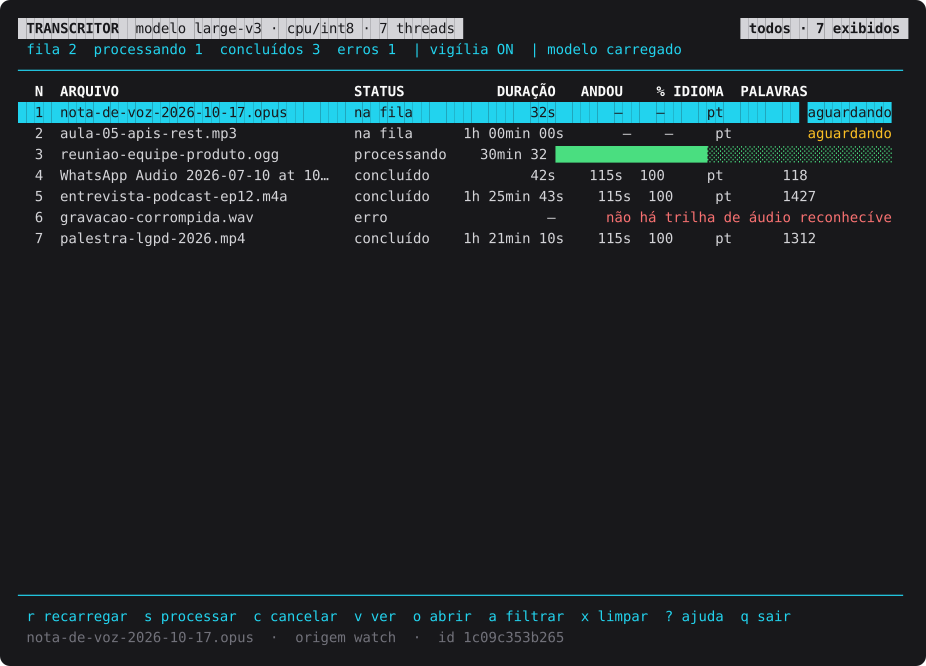
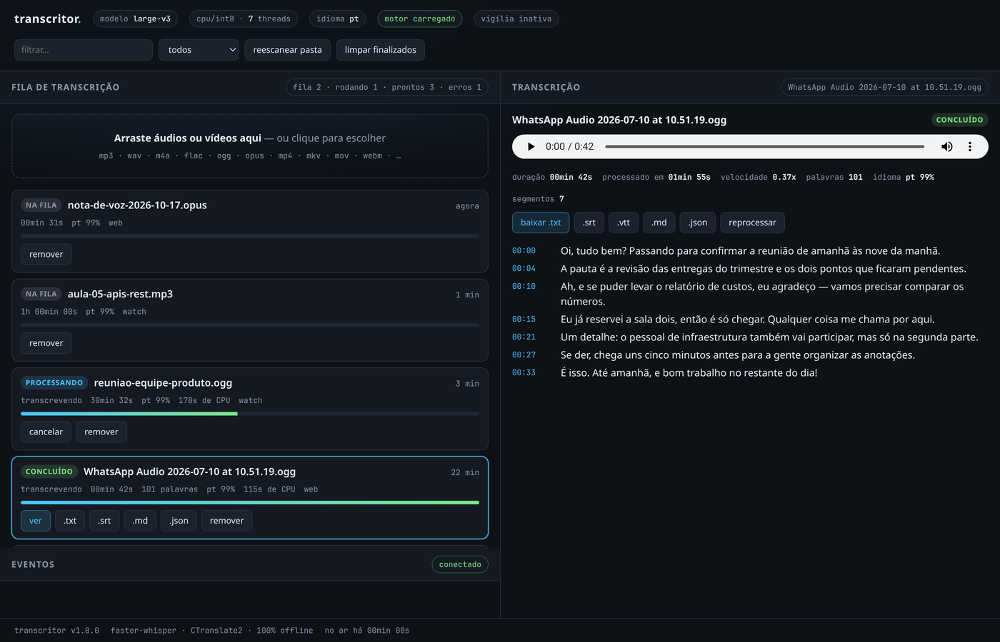

<p align="center">
  <picture>
    <source media="(prefers-color-scheme: dark)" srcset="docs/img/logo-escuro.svg">
    
  </picture>
</p>

<h1 align="center">transcritor</h1>

<p align="center">Transcrição de áudio e vídeo local, com foco em português do Brasil e pontuação legível.</p>

<p align="center">
  <a href="LICENSE"></a>
  
  <a href="https://github.com/a32fred/transcritor/actions/workflows/ci.yml"></a>
  
  
</p>

O **transcritor** é uma ferramenta open source para transformar reuniões, entrevistas, aulas e mensagens de voz em texto e legendas sem enviar gravações para serviços externos. Usa faster-whisper e CTranslate2, por padrão em CPU com `int8` e modelo `large-v3`, com prompt inicial voltado à pontuação em PT-BR. Depois de instalar as dependências e baixar o modelo escolhido, a transcrição funciona inteiramente offline, sem chave de API. Versão **1.0.0**, por [Frederico Carlos (@a32fred)](https://github.com/a32fred).

## Sumário

- [Demonstração / Capturas](#demonstração--capturas)
- [Funcionalidades](#funcionalidades)
- [Requisitos e Instalação](#requisitos-e-instalação)
- [Início rápido](#início-rápido)
- [Uso](#uso)
  - [transcribe](#transcribe)
  - [detect](#detect)
  - [watch](#watch)
  - [serve](#serve)
  - [tui](#tui)
  - [jobs](#jobs)
  - [models](#models)
  - [config](#config)
  - [doctor](#doctor)
  - [info](#info)
- [Formatos suportados](#formatos-suportados)
- [Como funciona](#como-funciona)
- [Desempenho](#desempenho)
- [Configuração](#configuração)
- [Execução automática (systemd)](#execução-automática-systemd)
- [API HTTP](#api-http)
- [Solução de problemas](#solução-de-problemas)
- [Perguntas frequentes (FAQ)](#perguntas-frequentes-faq)
- [Roadmap](#roadmap)
- [Contribuindo](#contribuindo)
- [Licença](#licença)
- [Agradecimentos](#agradecimentos)

## Demonstração / Capturas

### Painel no terminal



### Interface web local



A interface web tem tema escuro, envio de múltiplos arquivos por arrastar-e-soltar, filtros por nome e status, progresso ao vivo e registro de eventos. O visualizador oferece downloads e um player do original com timestamps clicáveis e destaque do segmento em reprodução; a reprodução depende dos codecs aceitos pelo navegador.

## Funcionalidades

| Recurso | O que faz |
| --- | --- |
| Processamento local | Modelo e gravações ficam na máquina; nenhuma chamada externa durante a transcrição com o modelo já disponível localmente. |
| PT-BR por padrão | Idioma `pt`, prompt inicial pontuado e contexto entre segmentos. A qualidade ainda depende da gravação. |
| Três interfaces | CLI com Click, TUI com curses e web local com biblioteca padrão e Jinja2. |
| Lotes | Aceita vários arquivos e percorre pastas recursivamente na CLI. |
| Pasta vigiada | Monitora a entrada por polling e espera o arquivo estabilizar antes de enfileirar. |
| Fila persistente | `watch`, `serve` e `tui` registram jobs em JSON; consulta e reprocessamento por `jobs`. |
| Áudio de vídeos | Extrai e processa a trilha de áudio; não analisa as imagens. |
| Cinco saídas | TXT, SRT, VTT, JSON e Markdown, selecionáveis e gravados em UTF-8. |
| Pré-processamento | Conversão para WAV mono de 16 kHz, com normalização de volume opcional. |
| Idiomas e tradução | Detecção de idioma e tradução da fala para inglês com a tarefa `translate`. |
| Progresso | Percentual, prévia, velocidade e estimativa de tempo quando há duração disponível; web usa SSE. |
| Modelos alternativos | Download, consulta e seleção de modelos menores ou `large-v3-turbo`. |

> **Histórico:** `transcrever transcribe` é avulso e não cria jobs. Para histórico persistente, use `watch`, `serve` ou `tui`.

## Requisitos e Instalação

### Requisitos

- **Python 3.10 ou superior** e suporte a ambientes virtuais.
- **FFmpeg e ffprobe** no `PATH`, com codecs compatíveis com seus arquivos. O ffprobe é necessário mesmo com `--no-preprocess`.
- Espaço para dependências, modelo, saídas e áudio temporário. O `large-v3` ocupa aproximadamente **2,9 GB em disco**.
- RAM disponível para o modelo. O diagnóstico usa cerca de **2,5 GB livres** como referência para modelos `large`; isso não é garantia de consumo máximo.
- Internet para instalar dependências e baixar cada modelo; depois disso, não é necessária para transcrever.

Os exemplos usam Bash em Linux/macOS. A TUI requer um terminal interativo com curses; o serviço systemd é específico de Linux.

### Instalar FFmpeg

Execute apenas o bloco correspondente ao seu sistema:

```bash
# Fedora: o pacote completo pode exigir um repositório como RPM Fusion
sudo dnf install ffmpeg
```

```bash
# Debian / Ubuntu
sudo apt update
sudo apt install python3 python3-venv python3-pip ffmpeg
```

```bash
# Arch Linux
sudo pacman -S python python-pip ffmpeg
```

```bash
# macOS, com Homebrew
brew install python ffmpeg
```

Confirme que **os dois executáveis** estão disponíveis:

```bash
ffmpeg -version
ffprobe -version
```

### Preparar o projeto e o ambiente virtual

Obtenha o código em [github.com/a32fred/transcritor](https://github.com/a32fred/transcritor), extraia-o em `~/transcritor` e execute:

```bash
cd ~/transcritor
python3 -m venv .venv
source .venv/bin/activate
pip install -r requirements.txt
pip install -e .
```

As dependências incluem `faster-whisper`, `ctranslate2`, `huggingface_hub`, `jinja2`, `click`, `numpy` e `av`. A instalação editável disponibiliza o comando **`transcritor`** no ambiente virtual.

### Instalar o comando `transcrever`

O nome em português é oferecido pelo lançador `bin/transcrever`. Para chamá-lo de qualquer pasta:

```bash
cd ~/transcritor
chmod +x bin/transcrever
mkdir -p ~/.local/bin
ln -s "$PWD/bin/transcrever" ~/.local/bin/transcrever
export PATH="$HOME/.local/bin:$PATH"
export TRANSCRITOR_PYTHON="$PWD/.venv/bin/python"
transcrever --version
```

Se o link já existir, confira seu destino antes de alterá-lo. Adicione os dois `export` ao arquivo de inicialização do seu shell para persistir a configuração. `TRANSCRITOR_PYTHON` informa ao lançador qual Python usar; alternativamente, mantenha o ambiente virtual ativado. Não é necessário um link para executar `./bin/transcrever` diretamente.

O lançador define `TRANSCRITOR_HOME` como a raiz do projeto, salvo se a variável já estiver definida. O comando instalado `transcritor` usa `~/transcritor` por padrão; para manter os mesmos dados em outra localização, defina `TRANSCRITOR_HOME` explicitamente.

### Baixar o modelo

```bash
transcrever models download large-v3
transcrever doctor
```

O modelo fica em `models/faster-whisper-large-v3` dentro de `TRANSCRITOR_HOME`. O download é feito pelo Hugging Face; uma vez disponível localmente, o motor o abre sem buscar arquivos na rede. Escolher um modelo ainda não baixado pode iniciar um novo download.

## Início rápido

Depois de instalar FFmpeg e obter o código, o caminho mínimo é:

```bash
cd ~/transcritor
python3 -m venv .venv
source .venv/bin/activate
pip install -r requirements.txt
./bin/transcrever models download large-v3
./bin/transcrever transcribe /caminho/para/reuniao.mp3
cat var/outbox/reuniao/transcricao.txt
```

Por padrão, também serão gerados `transcricao.srt`, `transcricao.vtt`, `transcricao.json` e `transcricao.md` na mesma pasta. Em caso de colisão de nomes, consulte o diretório informado ao final da execução.

Prefere não usar a linha de comando para escolher os arquivos?

```bash
transcrever serve --open
```

Abra ou acesse `http://127.0.0.1:8765/`, envie um arquivo e selecione o job concluído para ler ou baixar a transcrição.

## Uso

Os exemplos abaixo usam `transcrever`; `transcritor` e `python -m transcritor` acessam a mesma CLI, respeitando a configuração de caminhos descrita acima.

```bash
transcrever --help
transcrever --version
transcrever transcribe --help
```

Opções globais devem vir **antes do comando**:

| Opção | Função |
| --- | --- |
| `--config ARQUIVO` | Carrega uma configuração JSON alternativa. |
| `-v`, `--verbose` | Habilita logs detalhados. |
| `-q`, `--quiet` | Reduz os logs para avisos e erros; não suprime todas as mensagens da CLI. |
| `--version` | Mostra a versão. |
| `-h`, `--help` | Exibe a ajuda da CLI raiz. Nos subcomandos, use `--help`. |

### transcribe

Transcreve um ou mais arquivos, ou os arquivos de mídia de uma pasta e suas subpastas. Não registra o resultado no histórico de jobs.

```bash
transcrever transcribe reuniao.mp3
transcrever transcribe entrevista.wav aula.mp4
transcrever transcribe ~/Downloads/audios/
transcrever transcribe aula.mp4 -f txt --format srt
transcrever transcribe entrevista.wav -o ./resultado
transcrever transcribe voz.ogg --loudnorm
transcrever transcribe audio.mp3 --no-preprocess
transcrever transcribe audio.mp3 --stdout
transcrever transcribe audio.mp3 -m small --beam-size 1
transcrever transcribe audio.mp3 -l auto
transcrever transcribe audio.mp3 -t translate -f txt
transcrever transcribe audio.mp3 --word-timestamps -f json
transcrever transcribe audio.mp3 --prompt "Bom dia! Esta é uma entrevista em português do Brasil."
```

| Opção | Função |
| --- | --- |
| `-o`, `--out PASTA` | Diretório de saída explícito; por padrão, usa uma subpasta de `outbox`. |
| `-m`, `--model MODELO` | Substitui o modelo nesta execução. |
| `-l`, `--language IDIOMA` | Define `pt`, `en`, `es` etc.; `auto` habilita detecção. |
| `-t`, `--task transcribe\|translate` | Mantém o idioma ou traduz para inglês. |
| `-f`, `--format FORMATO` | Seleciona saída; repetível, com `txt`, `srt`, `vtt`, `json` ou `md`. |
| `--no-preprocess` | Pula a conversão por FFmpeg; mantém a inspeção por ffprobe. |
| `--loudnorm` | Normaliza o volume durante o pré-processamento. Não tem efeito com `--no-preprocess`. |
| `--word-timestamps` | Inclui tempos e probabilidades por palavra no JSON. |
| `--beam-size N` | Define beam search; `1` prioriza velocidade, padrão `5`. |
| `--prompt TEXTO` | Substitui o prompt inicial. |
| `--no-vad` | Desliga a detecção de fala. |
| `--stdout` | Também imprime o texto no terminal, em vez do resumo final. Veja a ressalva abaixo. |
| `--yes` | Aceita a opção, mas a implementação atual não a utiliza nem pede confirmação de tamanho. |

> **Comportamento real de `--stdout`:** apesar da descrição na ajuda, o pipeline ainda grava as saídas. Mensagens de andamento também vão para stdout; portanto, não é uma saída de texto puro para redirecionamento. Para obter somente o texto renderizado, leia o `transcricao.txt` gerado.

Ao usar `--out` com vários arquivos, todos escrevem os mesmos nomes nessa pasta e podem sobrescrever as saídas anteriores. Para lotes, prefira o diretório automático por arquivo.

### detect

Detecta o idioma a partir do início da gravação, sem percorrer toda a transcrição. Ainda precisa carregar o modelo. Aceita vários arquivos e pastas; não possui opções específicas além da ajuda.

```bash
transcrever detect voz.ogg entrevista.wav
transcrever detect ~/Downloads/audios/
```

### watch

Vigia `var/inbox` recursivamente, cria jobs e processa os arquivos após a estabilização de tamanho e data de modificação.

```bash
transcrever watch
transcrever watch --once
transcrever watch --interval 10 --workers 1 -f txt -f srt
transcrever watch -m large-v3-turbo --loudnorm
```

| Opção | Função |
| --- | --- |
| `--once` | Observa a estabilidade, enfileira arquivos prontos, processa jobs pendentes em série e sai. |
| `-i`, `--interval SEGUNDOS` | Intervalo de varredura; padrão `5.0`. |
| `-w`, `--workers N` | Quantidade de workers; padrão `1`. |
| `-f`, `--format FORMATO` | Formatos de saída, repetível. |
| `--delete-source` | Apaga o original de jobs originados pelo watcher **após o sucesso**. Use apenas com cópias de segurança. |
| `-m`, `--model MODELO` | Modelo desta execução. |
| `--loudnorm` | Normalização de volume. |

O watcher espera `3.0` segundos de estabilidade por padrão, observados nas varreduras. Um caminho já presente no histórico é ignorado pelo watcher, inclusive se seu job falhou: use `jobs retry` para tentar novamente. `watch --once` é útil para agendadores, mas seu término normal não significa que todos os jobs tiveram sucesso; confira a contagem e o histórico.

### serve

Inicia o servidor web local e, por padrão, também vigia a pasta de entrada.

```bash
transcrever serve --open
transcrever serve --host 127.0.0.1 --port 8766 --no-watch
transcrever serve -m large-v3-turbo -f txt -f json
```

Opções: `--host`, `-p/--port`, `--open`, `--no-watch`, `-m/--model` e `-f/--format` repetível. O endereço padrão é `http://127.0.0.1:8765/`. Sem o watcher, os uploads continuam entrando diretamente na fila.

> **Segurança:** o servidor não implementa autenticação nem TLS e permite adicionar caminhos locais e acessar arquivos dos jobs. Mantenha `127.0.0.1`; expor a interface em outro endereço exige proteção externa e uma rede confiável. “Local” não significa seguro para publicar na internet.

### tui

Abre o painel curses no terminal, com fila, progresso e visualização de transcrições. Também inicia o watcher por padrão.

```bash
transcrever tui
transcrever tui --no-watch -m small
```

Opções: `--no-watch` e `-m/--model`. Use `?` para abrir a ajuda; `r` reescaneia a entrada, `s` envia pendentes para processamento, `v` abre a transcrição selecionada e `q` sai. Requer terminal interativo: não funciona com stdout redirecionado.

### jobs

Consulta e gerencia os registros persistidos em `var/state.json`.

```bash
transcrever jobs list
transcrever jobs list --status error --limit 10
transcrever jobs list -n 50 --json
transcrever jobs show ID_DO_JOB
transcrever jobs show ID_DO_JOB --format srt
transcrever jobs retry ID_DO_JOB -f txt -f json
transcrever jobs retry --failed
transcrever jobs retry --failed --yes
transcrever jobs rm ID_DO_JOB
transcrever jobs clear
```

| Subcomando | Opções e comportamento |
| --- | --- |
| `list` | `--status queued\|running\|done\|error\|canceled`, `-n/--limit` (padrão `30`) e `--json`. |
| `show ID` | Imprime um artefato disponível; `--format` seleciona o formato, padrão `txt`. |
| `retry [ID]` | Reprocessa em série; `--failed` seleciona todos com erro, `--yes` dispensa a confirmação do lote e `-f/--format` é repetível. O original precisa existir. |
| `rm ID` | Remove apenas o registro, sem apagar o original ou as saídas. |
| `clear` | Remove registros finalizados, incluindo erros e cancelados; preserva fila e execução. Pede confirmação, dispensável com `--yes`. |

Jobs que estavam `running` quando o processo terminou são carregados como `error`. Jobs `queued` são retomados ao iniciar um consumidor. Remover registros de arquivos que permanecem na inbox permite que o watcher os descubra novamente.

### models

```bash
transcrever models list
transcrever models download large-v3
transcrever models download large-v3-turbo
transcrever models use large-v3-turbo
```

Modelos conhecidos: `tiny`, `base`, `small`, `medium`, `large-v2`, `large-v3` e `large-v3-turbo`. `list` mostra disponibilidade local e tamanho; `download NOME` baixa ou revalida; `use NOME` salva a escolha padrão, mas não faz o download.

Para um repositório CTranslate2 diferente, `download` aceita o argumento literal `repo/qualquer` com `--repo`:

```bash
transcrever models download repo/qualquer --repo Systran/faster-whisper-small
```

Nesse caso, use depois o caminho local informado pelo download como valor de `model`; `models use` aceita apenas os nomes conhecidos.

### config

```bash
transcrever config show
transcrever config show --json
transcrever config set language=pt beam_size=5
transcrever config set formats=txt,srt,json txt_timestamps=true
transcrever config init
transcrever --config ./outra-config.json config show
```

`show --json` exibe os valores efetivos em JSON. `set` recebe um ou mais pares `chave=valor`; listas são separadas por vírgula. `init` cria a configuração no caminho efetivo e recusa sobrescrever um arquivo existente, salvo com `--force`. Confira [Configuração](#configuração) antes de alterar parâmetros avançados.

### doctor

```bash
transcrever doctor
```

Verifica dependências, FFmpeg/ffprobe, disponibilidade do modelo, memória quando possível e permissões das pastas. GPU é opcional. Retorna código diferente de zero quando encontra pendências; não executa uma transcrição de validação.

### info

```bash
transcrever info
```

Mostra versão, caminhos efetivos, modelo, dispositivo, threads, idioma, tarefa, formatos, contagem de jobs e endereço web configurado. Não inicia o servidor.

## Formatos suportados

### Entrada

A lista abaixo contém **todas as 23 extensões** de `AUDIO_EXTENSIONS`. A comparação ignora maiúsculas/minúsculas. A extensão permite selecionar o arquivo; a leitura real depende do contêiner, codec e suporte do FFmpeg instalado.

| Grupo | Extensões aceitas |
| --- | --- |
| Áudio | `.mp3`, `.wav`, `.m4a`, `.aac`, `.flac`, `.ogg`, `.oga`, `.opus`, `.wma`, `.aiff`, `.aif`, `.amr` |
| Contêineres de áudio/vídeo | `.mp4`, `.mkv`, `.mov`, `.webm`, `.m4v`, `.avi`, `.3gp`, `.mpeg`, `.mpg`, `.ts`, `.wmv` |

Vídeos precisam conter uma trilha de áudio. **Áudios `.ogg` do WhatsApp funcionam**, inclusive quando o codec é Opus; não é necessário renomeá-los para `.mp3`.

### Saída

| Formato | Arquivo gerado | Conteúdo |
| --- | --- | --- |
| `txt` | `transcricao.txt` | Título e texto agrupado em parágrafos por pausas e limites de duração; timestamps opcionais. |
| `srt` | `transcricao.srt` | Legendas numeradas, divididas por tamanho e duração, com timestamps SRT. |
| `vtt` | `transcricao.vtt` | Legendas WebVTT para players e páginas web. |
| `json` | `transcricao.json` | Texto completo, idioma, duração, desempenho e segmentos com timestamps; palavras quando habilitadas. |
| `md` | `transcricao.md` | Markdown com tabela de metadados e parágrafos com timestamps. |

Por padrão, os cinco formatos são gerados em `var/outbox/<nome>/`, acompanhados de `.meta.json`, usado para metadados internos e identificação da origem. TXT/Markdown preservam a pontuação do modelo; não há um serviço externo de revisão. A segmentação das legendas distribui o tempo dentro dos segmentos, sem garantia de alinhamento exato de cada palavra.

## Como funciona

```text
watch / TUI / Web ----> JobStore (var/state.json)
                               |
CLI jobs retry ----------------+--> Runner
                                      |
CLI transcribe (avulso) ---------------+--> Pipeline
                                              |
                                              +--> probe (ffprobe)
                                              +--> normalização (ffmpeg)
                                              +--> Engine (faster-whisper)
                                              +--> renderização
                                                       |
                                                       v
                                              var/outbox/<nome>/
                                              txt / srt / vtt / json / md
```

1. **Inspeção:** ffprobe lê duração, codecs e trilhas. Arquivos sem áudio reconhecível falham antes da inferência.
2. **Normalização:** FFmpeg extrai a fala para WAV PCM de **16 kHz, mono** em `var/work`. `--loudnorm` adiciona normalização de volume; `--no-preprocess` pula a conversão no modo avulso. Se a conversão falhar, o pipeline tenta o original.
3. **Transcrição:** a Engine carrega o modelo sob demanda, aplica VAD e parâmetros de decodificação e emite progresso por segmentos. O Runner reutiliza uma única Engine por processo.
4. **Renderização:** o pipeline gera os formatos selecionados, grava metadados e limpa o diretório temporário após sucesso.

O JobStore usa escrita atômica e proteção entre threads, **não um lock entre processos**. As interfaces usam o mesmo formato de fila e podem consultar o mesmo histórico, mas não são um sistema distribuído: evite executar vários consumidores independentes (`watch`, `serve`, `tui` ou `jobs retry`) simultaneamente sobre o mesmo `state_file`. Para alternar a interface, encerre o consumidor anterior.

## Desempenho

Referência real observada na máquina de desenvolvimento, não uma promessa para qualquer hardware:

| Item | Referência |
| --- | --- |
| CPUs lógicas | 8 |
| GPU | Sem GPU |
| Configuração | `large-v3`, CPU, `int8`, 7 threads |
| Velocidade | Aproximadamente **0,4x a 0,8x do tempo real** |
| Carregamento do modelo | Aproximadamente **6–7 segundos** |
| Modelo em disco | Aproximadamente **2,9 GB**, em `models/faster-whisper-large-v3` |

A velocidade exibida pelo código é **duração do áudio ÷ tempo de transcrição**: abaixo de `1x` é mais lento que o tempo real; acima de `1x`, mais rápido. O carregamento e o pré-processamento acrescentam tempo ao total. Gravação, quantidade de silêncio, modelo e concorrência alteram bastante os resultados.

Para melhorar:

- Experimente `small`, `medium` ou `large-v3-turbo`, medindo também a qualidade no seu material.
- Use `--no-preprocess` em arquivos já adequados, sabendo que reduz a robustez e não elimina ffprobe.
- Reduza `--beam-size` para `1`, ou `beam_size` na configuração, aceitando a possível perda de qualidade.
- Ajuste `cpu_threads` e mantenha `watch_workers=1` como ponto de partida para não saturar a máquina.
- Mantenha um consumidor aberto para reutilizar o modelo entre arquivos.
- Com GPU NVIDIA compatível e bibliotecas CUDA/cuDNN adequadas à versão do CTranslate2, configure explicitamente:

```bash
transcrever config set device=cuda compute_type=float16
```

Isso não instala CUDA automaticamente. Para voltar à CPU:

```bash
transcrever config set device=cpu compute_type=int8
```

## Configuração

Sem opções específicas de comando, a precedência é **variáveis de ambiente > `config.json` > padrões do código**. As opções de comando implementadas como substituições são aplicadas depois da carga e prevalecem naquela execução.

O arquivo padrão é `$TRANSCRITOR_HOME/config.json`, ou `~/transcritor/config.json`. `--config ARQUIVO` escolhe outro JSON e os comandos que salvam configuração escrevem nesse mesmo caminho. Consulte [config.example.json](config.example.json) para um exemplo inicial; `config show --json` mostra todos os campos efetivos.

### Caminhos

Os caminhos relativos à home abaixo são derivados quando o respectivo campo não é informado. Aqui, `home` significa o valor efetivo desse campo.

| Campo | Padrão | Finalidade |
| --- | --- | --- |
| `home` | `~/transcritor` | Diretório base; o lançador usa a raiz do projeto se `TRANSCRITOR_HOME` não estiver definido. |
| `inbox` | `home/var/inbox` | Entrada do watcher e destino dos uploads. |
| `outbox` | `home/var/outbox` | Artefatos gerados. |
| `work` | `home/var/work` | Arquivos temporários. |
| `models_dir` | `home/models` | Modelos locais. |
| `state_file` | `home/var/state.json` | Histórico persistente. |
| `log_file` | `home/var/transcritor.log` | Caminho configurável; a CLI atual não instala um handler de arquivo automaticamente. |

`TRANSCRITOR_HOME` seleciona a home inicial e a localização padrão do JSON; um campo `home` explícito no JSON e caminhos explicitamente salvos continuam sendo respeitados. Para mover uma instalação, revise esses caminhos em vez de assumir que serão todos recalculados.

### Motor

| Campo | Padrão | Finalidade |
| --- | --- | --- |
| `model` | `"large-v3"` | Modelo conhecido ou caminho/repositório compatível. |
| `device` | `"cpu"` | `cpu`, `cuda` ou `auto`; nesta aplicação, `auto` é convertido para `cpu`. |
| `compute_type` | `"int8"` | Tipo de cálculo do CTranslate2. |
| `cpu_threads` | `0` na declaração → `max(1, CPUs - 1)` | Valores não positivos são resolvidos na inicialização; 8 CPUs resultam em 7 threads. |
| `num_workers` | `1` | Workers internos do modelo, distintos dos workers da fila. |
| `beam_size` | `5` | Largura da busca. |
| `patience` | `1.0` | Paciência do beam search. |
| `length_penalty` | `1.0` | Penalidade de comprimento. |
| `repetition_penalty` | `1.0` | Penalidade de repetição. |
| `no_repeat_ngram_size` | `0` | Restrição de repetição de n-gramas. |
| `temperatures` | `[0.0, 0.2, 0.4, 0.6, 0.8, 1.0]` | Temperaturas de fallback. |
| `compression_ratio_threshold` | `2.4` | Limiar de compressão para fallback. |
| `log_prob_threshold` | `-1.0` | Limiar de log-probabilidade. |
| `no_speech_threshold` | `0.6` | Limiar de ausência de fala. |
| `condition_on_previous_text` | `true` | Mantém contexto entre segmentos; pode propagar erros ou repetições. |
| `prompt_reset_on_temperature` | `0.5` | Limiar de temperatura para reiniciar o prompt. |
| `hallucination_silence_threshold` | `2.0` | Parâmetro de silêncio encaminhado ao faster-whisper; seu efeito depende das condições do backend, inclusive timestamps por palavra. |
| `word_timestamps` | `false` | Inclui informações por palavra. |

### Idioma e tarefa

| Campo | Padrão | Finalidade |
| --- | --- | --- |
| `language` | `"pt"` | Idioma da fala; string vazia `""` ativa detecção na configuração. |
| `task` | `"transcribe"` | `translate` traduz para inglês. |
| `initial_prompt` | Texto abaixo | Orienta o estilo e a pontuação, sem garantir correção. |
| `hotwords` | `""` | Vocabulário contextual adicional encaminhado ao motor. |

Prompt inicial padrão, na íntegra:

```text
Transcrição em português do Brasil com pontuação completa: vírgulas, pontos finais, interrogações, exclamações e travessões. Nomes próprios e siglas são escritos corretamente e em maiúsculas.
```

### VAD

| Campo | Padrão | Finalidade |
| --- | --- | --- |
| `vad` | `true` | Habilita detecção de fala. |
| `vad_threshold` | `0.5` | Limiar da detecção. |
| `vad_min_speech_ms` | `250` | Duração mínima de fala, em milissegundos. |
| `vad_min_silence_ms` | `500` | Silêncio mínimo para separação, em milissegundos. |
| `vad_speech_pad_ms` | `200` | Margem ao redor da fala, em milissegundos. |

### Saída

| Campo | Padrão | Finalidade |
| --- | --- | --- |
| `formats` | `["txt", "srt", "vtt", "json", "md"]` | Formatos gerados. |
| `txt_paragraph_gap` | `1.6` | Pausa em segundos para separar parágrafos. |
| `txt_max_chars_per_line` | `0` | Sem quebra forçada por largura; valor positivo também participa do agrupamento. |
| `txt_timestamps` | `false` | Adiciona timestamp ao início de cada parágrafo no TXT. |

### Watcher

| Campo | Padrão | Finalidade |
| --- | --- | --- |
| `watch_interval` | `5.0` | Intervalo entre varreduras, em segundos. |
| `watch_settle_seconds` | `3.0` | Tempo mínimo de estabilidade observado. |
| `watch_workers` | `1` | Workers da fila. |
| `watch_delete_source` | `false` | Apaga originais de jobs do watcher após sucesso. |
| `watch_include_video` | `true` | Inclui extensões classificadas como vídeo pelo código. |

### Web

| Campo | Padrão | Finalidade |
| --- | --- | --- |
| `web_host` | `"127.0.0.1"` | Endereço de escuta. |
| `web_port` | `8765` | Porta HTTP. |

### Variáveis de ambiente

Somente estas variáveis têm tratamento explícito na configuração:

| Variável | Alvo |
| --- | --- |
| `TRANSCRITOR_HOME` | Home inicial e localização padrão do JSON. |
| `TRANSCRITOR_MODEL` | `model` |
| `TRANSCRITOR_LANGUAGE` | `language` |
| `TRANSCRITOR_DEVICE` | `device` |
| `TRANSCRITOR_COMPUTE_TYPE` | `compute_type` |
| `TRANSCRITOR_WATCH_INTERVAL` | `watch_interval` |
| `TRANSCRITOR_WATCH_DELETE` | `watch_delete_source` |
| `TRANSCRITOR_WORD_TIMESTAMPS` | `word_timestamps` |
| `TRANSCRITOR_WEB_HOST` | `web_host` |
| `TRANSCRITOR_WEB_PORT` | `web_port` |

O lançador também lê `TRANSCRITOR_PYTHON`, que seleciona o interpretador e não é um campo de `Config`. Booleanos aceitam `1`, `true`, `yes`, `on` ou `sim` para verdadeiro.

Exemplo de configuração parcial válida:

```json
{
  "model": "large-v3",
  "device": "cpu",
  "compute_type": "int8",
  "language": "pt",
  "beam_size": 5,
  "formats": ["txt", "srt", "json"],
  "txt_timestamps": true,
  "watch_delete_source": false
}
```

## Execução automática (systemd)

O projeto inclui um serviço **de usuário** em [docs/transcritor-watch.service](docs/transcritor-watch.service). Ele pressupõe a instalação em `~/transcritor`, usa o lançador `bin/transcrever`, reinicia após falhas e reduz a prioridade de CPU/E/S.

```bash
cd ~/transcritor
mkdir -p ~/.config/systemd/user
cp docs/transcritor-watch.service ~/.config/systemd/user/
```

Antes de iniciar, ajuste os caminhos se necessário. Se as dependências estiverem no ambiente virtual, configure o interpretador por um override:

```bash
systemctl --user edit transcritor-watch
```

Inclua, substituindo o caminho pelo caminho absoluto da sua instalação:

```ini
[Service]
Environment=TRANSCRITOR_PYTHON=/home/SEU_USUARIO/transcritor/.venv/bin/python
```

Depois:

```bash
systemctl --user daemon-reload
systemctl --user enable --now transcritor-watch
systemctl --user status transcritor-watch
journalctl --user -u transcritor-watch -f
```

O serviço acompanha a sessão do usuário; execução sem login depende da configuração do systemd da máquina. Para usar web ou TUI sobre a mesma fila, pare primeiro o serviço:

```bash
systemctl --user stop transcritor-watch
```

## API HTTP

Disponível enquanto `transcrever serve` estiver ativo. A tabela reproduz as rotas documentadas em `transcritor/web/server.py`, com as rotas auxiliares também conferidas na implementação.

| Método | Caminho | Função |
| --- | --- | --- |
| `GET` | `/` | Interface web. |
| `GET` | `/api/status` | Modelo, contadores, caminhos e estado do motor/watcher. |
| `GET` | `/api/jobs` | Lista de jobs, limitada aos 300 mais recentes. |
| `POST` | `/api/upload?name=arq.mp3` | Recebe bytes crus do arquivo, grava na inbox e enfileira. |
| `POST` | `/api/jobs` | Adiciona arquivos locais existentes, com JSON `{"paths": [...]}`. |
| `POST` | `/api/jobs/{id}/cancel` | Solicita cancelamento. |
| `POST` | `/api/jobs/{id}/retry` | Reenfileira o job. |
| `DELETE` | `/api/jobs/{id}` | Remove o registro do histórico, não os arquivos. |
| `POST` | `/api/jobs/clear` | Limpa os registros finalizados. |
| `GET` | `/api/transcript/{id}` | Lê a saída; `?format=txt`, `md`, `srt`, `vtt` ou `json`. Padrão `txt`. |
| `GET` | `/api/download/{id}/{fmt}` | Baixa um formato gerado para o job. |
| `GET` | `/api/audio/{id}` | Serve o arquivo original com suporte a `Range`. |
| `GET` | `/api/models` | Modelos conhecidos, disponibilidade local e modelo ativo. |
| `GET` | `/api/events` | Progresso e eventos por Server-Sent Events. |
| `POST` | `/api/scan` | Rota auxiliar: solicita uma varredura do watcher; sem watcher, retorna zero. |
| `GET` | `/favicon.ico` | Rota auxiliar: responde sem conteúdo (`204`). |

Exemplos com o servidor no endereço padrão:

```bash
curl http://127.0.0.1:8765/api/status
curl -X POST 'http://127.0.0.1:8765/api/upload?name=voz.ogg' \
  -H 'Content-Type: application/octet-stream' \
  --data-binary @voz.ogg
curl -X POST http://127.0.0.1:8765/api/jobs \
  -H 'Content-Type: application/json' \
  -d '{"paths":["/caminho/absoluto/reuniao.mp3"]}'
curl 'http://127.0.0.1:8765/api/transcript/ID_DO_JOB?format=txt'
curl -N http://127.0.0.1:8765/api/events
```

O upload não é multipart: o corpo é o próprio arquivo. Caminhos enviados em JSON são caminhos **da máquina do servidor**, não do computador do navegador. Para jobs ainda não concluídos, a rota de transcrição responde com estado/progresso em JSON. Formatos não gerados não estarão disponíveis para leitura/download.

## Solução de problemas

### FFmpeg ou ffprobe não encontrado

Instale ambos e execute `transcrever doctor`. A ausência de ffprobe pode aparecer como falta de trilha de áudio, pois a inspeção não consegue reconhecê-la. `--no-preprocess` não contorna essa verificação.

### Modelo demora a baixar ou o download falha

O `large-v3` tem aproximadamente 2,9 GB. Verifique conectividade com o Hugging Face, espaço livre e permissão em `models_dir`, então repita `transcrever models download large-v3`. Confira a disponibilidade com `models list` e `doctor`; um download interrompido não deve ser considerado pronto apenas porque a pasta existe. Para uma primeira experiência mais leve, baixe `small` e use `-m small`.

### “Não há trilha de áudio reconhecível”

Verifique se o arquivo não está vazio, corrompido ou incompleto e se ffprobe está instalado. Um vídeo sem áudio não pode ser transcrito. Inspecione um arquivo com:

```bash
ffprobe -v error -show_streams -show_format arquivo.webm
```

### Áudio muito baixo

```bash
transcrever transcribe voz.ogg --loudnorm
```

Não combine com `--no-preprocess`. A normalização ajusta volume, mas não recupera fala perdida, saturada ou encoberta por ruído.

### Pontuação ruim em PT-BR

Confira `language=pt`, mantenha um `initial_prompt` bem pontuado e comece com `large-v3`. `condition_on_previous_text=true` mantém contexto e pode ajudar a continuidade; se o modelo repetir ou propagar erros, compare com `false`. Um prompt orienta o estilo, não força uma transcrição perfeita. Revise nomes próprios, números e trechos ambíguos.

### Alucinações em silêncio ou repetições

Mantenha `vad=true`, revise seus limiares e confira `hallucination_silence_threshold`, cujo padrão é `2.0`. Esse parâmetro é encaminhado ao faster-whisper e não substitui o VAD; sua atuação depende do backend, podendo exigir timestamps por palavra. Compare também `condition_on_previous_text=false` se houver loops. Nenhum ajuste elimina completamente alucinações.

### Muito lento ou máquina sem resposta

Experimente `small` ou `large-v3-turbo`, `--beam-size 1` e menos concorrência. Ajuste threads com `transcrever config set cpu_threads=4 watch_workers=1`. Mais workers não significam maior desempenho em CPU já saturada. O primeiro arquivo também inclui o custo de carregar o modelo.

### Pouca memória

Feche aplicações pesadas, use `int8`, um modelo menor e um único consumidor. Não confunda tamanho do modelo em disco com pico de RAM; áudio, conversão e inferência também consomem recursos. A rotina de upload web recebe o arquivo inteiro em memória: para gravações grandes, prefira colocá-las na inbox ou usar a CLI.

### Acentos errados

Os arquivos são gravados em UTF-8. Se aparecerem caracteres ilegíveis, abra-os como UTF-8 e confira a codificação do terminal/editor. Se o texto está legível, mas as palavras foram reconhecidas incorretamente, confira o idioma, a qualidade da gravação e o modelo; codificação não corrige reconhecimento.

### Arquivos ignorados na pasta vigiada

O watcher ignora nomes iniciados por `.` ou `~$`, sufixos `.part`, `.tmp`, `.crdownload`, `.download`, `.filepart` e `.partial`, e extensões não suportadas. Também aguarda estabilidade e não reenfileira caminhos que já estejam no histórico. Confira `watch_include_video` e, para erros anteriores, use `jobs retry --failed`.

### O `.ogg` do WhatsApp não aparece no histórico

O formato é aceito. Se usou `transcribe`, a ausência no histórico é esperada: esse comando é avulso. Para registrar, coloque o arquivo na inbox com um consumidor ativo ou envie pela interface web. Use aspas em caminhos com espaços:

```bash
transcrever transcribe "WhatsApp Audio 2026-07-10 at 10.51.19.ogg"
```

## Perguntas frequentes (FAQ)

**É realmente offline?** Sim, com dependências e modelo já instalados. Downloads exigem rede; a interface web usa HTTP local entre navegador e processo, sem nuvem.

**Preciso de GPU?** Não. O padrão é CPU com `int8`; CUDA é opcional e precisa ser configurado explicitamente.

**Posso transcrever outros idiomas?** Sim. Use `-l` com o idioma ou `-l auto` no comando `transcribe`. O padrão é português.

**Traduz para português?** Não pela tarefa de tradução do Whisper: `-t translate` produz inglês. `transcribe` mantém o idioma da fala.

**Onde ficam os arquivos?** Por padrão, em `~/transcritor/var/outbox/<nome>/`. O lançador e `TRANSCRITOR_HOME` podem mudar a base; `info` mostra os caminhos efetivos.

**Por que `jobs list` não mostra minha transcrição?** `transcribe` não cria jobs. Use `watch`, `serve` ou `tui` para persistir o histórico.

**O original é apagado?** Não por padrão. A exclusão após sucesso é opcional para jobs do watcher com `--delete-source` ou `watch_delete_source=true`.

**Posso deixar web, TUI e watcher rodando juntos?** Não sobre o mesmo arquivo de estado. Há proteção entre threads, mas não coordenação entre processos; use um consumidor por fila.

## Roadmap

As sugestões abaixo são **ideias para discussão, não funcionalidades existentes nem promessas de entrega**:

- Tornar `--stdout` uma saída pura de texto, com controle explícito da gravação.
- Melhorar a coordenação entre processos que acessam a mesma fila.
- Ampliar a revisão de transcrições e o alinhamento das legendas.
- Explorar identificação de falantes e novos fluxos de exportação.
- Documentar mais benchmarks por hardware, modelo e tipo de gravação.

Propostas devem preservar o processamento local e explicitar qualquer dependência ou download adicional.

## Contribuindo

Leia [CONTRIBUTING.md](CONTRIBUTING.md) para orientações de contribuição. Relatos de problemas devem incluir versão, sistema, saída de `doctor`, comando utilizado e comportamento esperado/observado. Não publique gravações privadas; prefira amostras mínimas que possam ser compartilhadas.

Para rodar a suíte na raiz do projeto, com o ambiente virtual ativado:

```bash
pip install -r requirements.txt
pip install -e .
pip install pytest
python -m pytest tests/
```

Os testes usam um dublê determinístico do motor: **não precisam de GPU nem baixam modelos**. Alguns testes de mídia exigem FFmpeg/ffprobe; os testes com verificação de disponibilidade são pulados quando as ferramentas faltam. Instale ambos para exercitar os casos de mídia reais. A suíte cobre configuração, CLI, formatos, jobs, mídia, pipeline, watcher e servidor web; não substitui uma avaliação de reconhecimento com áudio real.

Ao propor alterações, mantenha os padrões do projeto, acrescente testes pertinentes e atualize a documentação se mudar comandos, configuração ou API.

## Licença

Distribuído sob a [licença MIT](LICENSE). Autor: **Frederico Carlos** ([a32fred](https://github.com/a32fred)). As dependências e os modelos mantêm suas próprias licenças.

## Agradecimentos

- [faster-whisper](https://github.com/SYSTRAN/faster-whisper) e [CTranslate2](https://github.com/OpenNMT/CTranslate2), pelo trabalho da Systran e dos colaboradores em inferência eficiente.
- [OpenAI Whisper](https://github.com/openai/whisper), pelos modelos de reconhecimento de fala.
- [FFmpeg](https://ffmpeg.org/), pela inspeção, decodificação e conversão de mídia.
